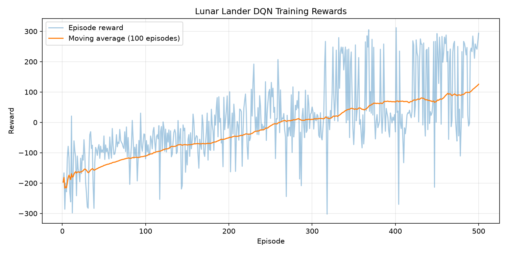
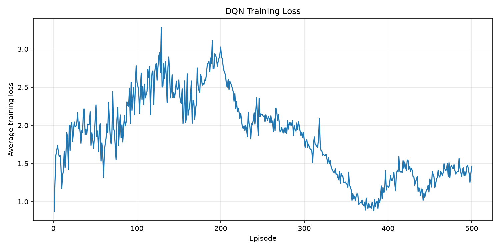

# Lunar Lander — Deep Q-Network (DQN)

A reinforcement learning project that trains an autonomous agent to control and land a spacecraft in the **LunarLander-v3** environment using **Deep Q-Learning (DQN)**, PyTorch, and Gymnasium.

The project demonstrates end-to-end reinforcement learning, including environment interaction, neural network training, experience replay, target network synchronisation, model evaluation, and performance visualisation.

## Project Overview

The goal is to train an intelligent agent to land a spacecraft safely on a designated landing pad while controlling its position, velocity, orientation, and fuel usage.

The agent learns through trial and error by interacting with the environment and receiving rewards based on its actions.

## Technologies Used

- Python
- PyTorch
- Gymnasium (Box2D)
- NumPy
- Matplotlib
- Deep Q-Network (DQN)
- Experience Replay
- Epsilon-Greedy Exploration

## Environment

**Environment:** `LunarLander-v3`

**State Space:** 8 continuous features representing:

1. Horizontal position
2. Vertical position
3. Horizontal velocity
4. Vertical velocity
5. Lander angle
6. Angular velocity
7. Left leg ground contact
8. Right leg ground contact

**Action Space:** 4 discrete actions:

- `0` — Do nothing
- `1` — Fire left orientation engine
- `2` — Fire main engine
- `3` — Fire right orientation engine

## DQN Architecture

The agent uses a fully connected neural network with two hidden layers.

| Layer | Configuration |
|---|---|
| Input | 8 state features |
| Hidden Layer 1 | 64 neurons + ReLU |
| Hidden Layer 2 | 64 neurons + ReLU |
| Output | 4 Q-values |

Each output represents the estimated value of taking one of the four possible actions.

## Reinforcement Learning Approach

The project implements the following techniques:

**Experience Replay:** Stores previous state transitions and randomly samples mini-batches to reduce correlations between training experiences.

**Epsilon-Greedy Exploration:** Balances random exploration and selecting actions based on predicted Q-values.

**Target Network:** Uses a separate neural network to calculate more stable Bellman targets.

**Bellman Equation:** Updates Q-value estimates using immediate rewards and discounted future rewards.

**Gradient Clipping:** Limits gradient magnitude to help stabilise training.

**Smooth L1 Loss:** Measures prediction error while reducing sensitivity to large outliers.

## Training Configuration

| Hyperparameter | Value |
|---|---|
| Training episodes | 500 |
| Replay buffer capacity | 100,000 |
| Batch size | 64 |
| Discount factor (gamma) | 0.99 |
| Learning rate | 0.0005 |
| Initial epsilon | 1.0 |
| Minimum epsilon | 0.05 |
| Epsilon decay | 0.995 |
| Target network update | Every 100 environment steps |
| Optimiser | Adam |
| Loss function | Smooth L1 |

## Training Results

The DQN agent was trained for 500 episodes.

**Final 100-episode average training reward: 125.80**

### Episode Rewards



The graph shows individual episode rewards and the 100-episode moving average, illustrating the agent's learning progress.

### Training Loss



The graph tracks the average neural network training loss per episode.

## Model Evaluation

The saved best-training model was evaluated across 20 episodes using greedy action selection.

| Evaluation Metric | Result |
|---|---|
| Mean reward | 136.76 |
| Standard deviation | 114.70 |
| Minimum reward | -8.75 |
| Maximum reward | 285.11 |
| Episodes scoring ≥200 | 10 / 20 |

The agent demonstrated promising learning behaviour and achieved high rewards in several episodes. However, performance varied across evaluation runs, indicating that additional training and hyperparameter optimisation could improve consistency.

## Project Structure

```text
lunar-lander-dqn/
├── dqn_model.py
├── replay_buffer.py
├── train.py
├── evaluate.py
├── requirements.txt
├── README.md
├── .gitignore
├── models/
│   └── dqn_lunar_lander_best.pth
└── outputs/
    ├── training_history.csv
    ├── training_rewards.png
    └── training_loss.png
```

Additional model checkpoints may be generated during training.

## Installation

Clone the repository:

```bash
git clone https://github.com/udhayakumar268/lunar-lander-dqn.git
cd lunar-lander-dqn
```

Create a virtual environment:

```bash
python -m venv .venv
```

Activate it on Windows PowerShell:

```powershell
.\.venv\Scripts\Activate.ps1
```

Install dependencies:

```bash
pip install -r requirements.txt
```

## Training the Agent

Run:

```bash
python train.py
```

The script trains the DQN agent, records training metrics, generates performance graphs, and saves model weights.

## Evaluating the Agent

Run:

```bash
python evaluate.py
```

The evaluation script loads the saved best-training model and measures its performance across 20 episodes.

## Future Improvements

- Train for more episodes and compare performance.
- Experiment with different learning rates and exploration schedules.
- Implement Double DQN to reduce Q-value overestimation.
- Experiment with Dueling DQN architecture.
- Evaluate across more random seeds for greater reliability.
- Record a demonstration video of the trained agent.

## Key Learnings

This project strengthened practical understanding of:

- Reinforcement learning and Markov decision processes
- Q-learning and Bellman equations
- Neural network training using PyTorch
- Experience replay and target networks
- Exploration versus exploitation
- Model evaluation and performance monitoring
- Reproducible machine learning workflows

## Author

**Udhaya Kumar**

MSc Artificial Intelligence — University of South Wales

GitHub: https://github.com/udhayakumar268

## Project Status

Training, model evaluation, and performance visualisation completed. Further optimisation is possible to improve landing consistency.